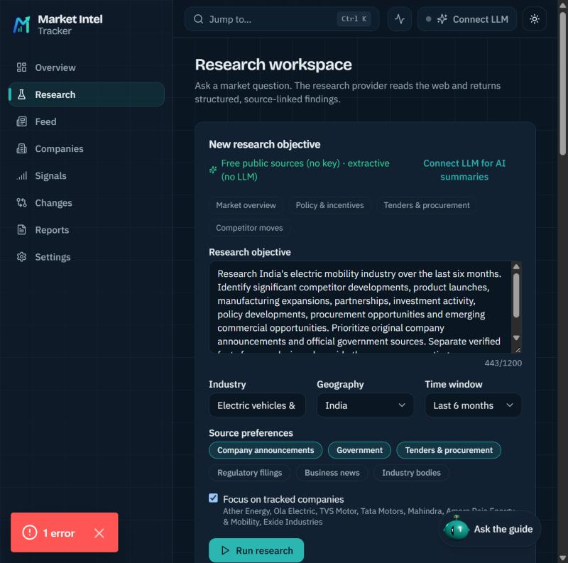
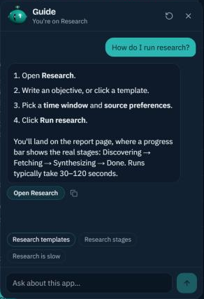
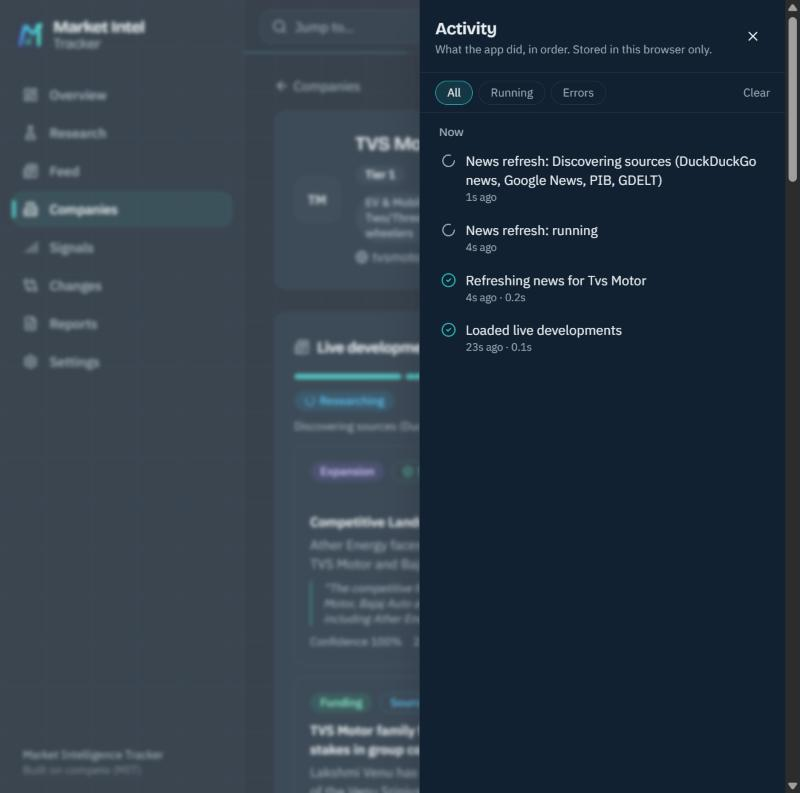
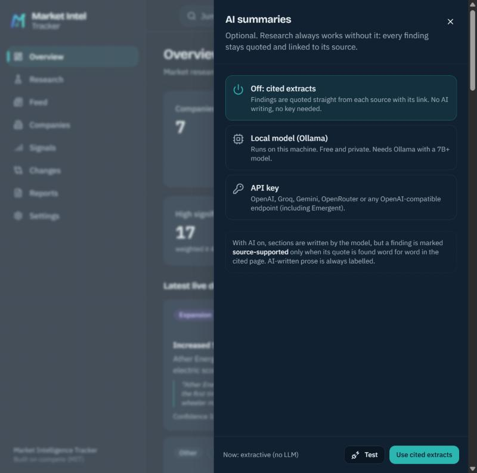

# Market Intelligence Tracker

**India-first AI market intelligence for businesses.** Company and competitor tracking, on-demand market research from **free public sources**, and government, policy and tender discovery. Findings are structured, labelled by provenance and linked to their sources. The demo vertical is Indian EV and mobility; the architecture is industry-agnostic.

> Built on [`yassnemo/compete`](https://github.com/yassnemo/compete) (MIT). The upstream licence and attribution are retained; the original README follows below.

| Research workspace | Guide assistant | Activity drawer | Connect LLM |
|---|---|---|---|
|  |  |  |  |

**Try it in 60 seconds:** run the quick start below, open **Marketing Analysis** and pick *Ather Energy*. A full strategy deck opens instantly. Click any grey source chip to see the exact quote and link.

**Highlights**
- **Marketing Analysis (new):** a consultant-style deck for any company, built in about 30 seconds.
  - **Key takeaways:** strongest moat, biggest competitive pressure, media tone and the first move to make.
  - **Thirteen sections:** Profitability, Moat, Stakeholder 2×2, Porter's Five Forces radar, Competition, Market attitude, Need gaps, Segmentation, Positioning map, Go-to-market timeline, 7P scorecard and prioritised to-dos.
  - **Sharing and comparison:** compare two companies head to head, copy a share link, or export an A4 PDF.
  - **Grounded claims:** every claim is either a quoted, linked source or labelled *Analysis*, *Forecast* or *AI analysis*. AI output is checked: any number not found in the cited source is rejected, and the AI never gives buy or sell advice.
- **Aurora theme:** a dark-first indigo design with glass panels, motion that respects reduced-motion settings, and a matching light mode. It is fully usable at 390 px.
- **Research from free public sources:** DuckDuckGo news, Google News, PIB (government) and GDELT, with every finding labelled by provenance and linked to its source.
- **Company tracking with "Refresh news":** live developments for each company, kept separate from the `[Sample]` demo data.
- **Guide assistant ("Volt"):** a 3D three.js companion bottom-right (or press **Ctrl+/**). It answers from a knowledge base of the real UI (`config/app_guide.yaml`), reads live run status from the database, explains "what just happened", and says so when it doesn't know. No LLM needed.
- **Always-visible transparency:** a top activity bar, a reading-progress bar, and an **Activity** drawer with every API call, page and research stage, plus completion and failure toasts.
- **Optional AI summaries** via **Connect LLM** (Ollama or any OpenAI-compatible key). Off by default.

## Deploy your own (free)

- **Easiest:** **Vercel** hosts the website and **Render** hosts the API, both on free plans, with your own domain. Setup is clicks only: see **[docs/GO_LIVE_VERCEL_RENDER.md](docs/GO_LIVE_VERCEL_RENDER.md)**.
- **Alternative:** one always-free Oracle VM, with no Docker. See [docs/GO_LIVE_ORACLE.md](docs/GO_LIVE_ORACLE.md).

Both run in **public mode**:
- Visitors can explore and run analyses, with rate limits per IP.
- Only the owner can change AI keys or the tracked companies.

The roadmap and remaining steps are in **[NEXT_STEPS.md](NEXT_STEPS.md)**.

## Quick start (free, no keys)

Windows PowerShell (macOS/Linux: same commands, `export` instead of `$env:`):

```powershell
uv sync --extra dev --extra dbt --extra api --extra report      # or: pip install -r requirements.txt
uv run uvicorn api.main:app --port 8000                          # first boot seeds demo data + real snapshot (~1-2 min)
cd web; npm install; npm run dev                                 # http://localhost:3000
```

- **Research works with no keys.** The default `COMPETE_RESEARCH_PROVIDER=open` searches DuckDuckGo news, Google News RSS, PIB press releases and GDELT, fetches the pages and builds an extractive report. Every finding is verbatim source text.
- **AI summaries (optional): click "Connect LLM" in the top bar.** Choose *Off* (default: cited extracts), *Local model (Ollama)* or *API key* (OpenAI, Groq, Gemini, OpenRouter or any OpenAI-compatible endpoint, including Emergent). Use **Test** to check the connection before saving. The key is stored server-side in `data/llm_settings.json` (gitignored) and never returned to the browser.
- **Optional: local LLM.** Install [Ollama](https://ollama.com) and run `ollama pull qwen2.5:7b-instruct`. With `COMPETE_RESEARCH_SYNTHESIS=auto`, reports get LLM-written sections, and a finding is marked "source-supported" only when its quote is found verbatim in the cited source.
- **Optional: Context.dev.** Set `CONTEXT_DEV_API_KEY` and `COMPETE_RESEARCH_PROVIDER=contextdev`. This is a paid provider; its findings are labelled "Provider-cited fact".
- **Hosting (Emergent and similar):** see [docs/EMERGENT_HANDOFF.md](docs/EMERGENT_HANDOFF.md). The backend serves every route under `/api` as well as `/`.

| Label | Meaning |
|---|---|
| Source excerpt | Verbatim text from the source (no generated prose) |
| Source-supported (quote verified) | LLM finding whose evidence quote was found in the cited source |
| Provider-cited fact | Context.dev says a source supports it; not independently verified |
| Analysis | Interpretation, or a citation that could not be verified |
| Demo snapshot / [Sample] | Preloaded sample data, never live |

---

# compete - Competitive Intelligence Platform

**Watch every move your competitors make.** compete runs scheduled agents over a
configurable list of competitors (websites, blogs, pricing pages, news, job
postings), extracts **structured signals** with an LLM, warehouses everything in
**DuckDB**, detects meaningful changes, and serves a polished, responsive
dashboard with auto-generated weekly reports.

### ➜ [**Live demo**](https://compete.yerradouani.me) &nbsp;·&nbsp; [Docs](https://compete.yerradouani.me/docs) &nbsp;·&nbsp; [Write-up](https://yerradouani.me)

[](LICENSE)
[](web/)
[](api/)
[](warehouse/)
[](warehouse/)
[](docs/DEPLOYMENT.md)

The public demo is fully **server-less**: every API response is baked to static
JSON and served from Vercel at **$0** (see
[ADR 0004](docs/adr/0004-static-snapshot-deploy.md)). A weekly GitHub Action
refreshes the data. Config-driven collection (static/dynamic/RSS/jobs),
snapshot-diff change detection, provider-agnostic LLM extraction, a dbt
warehouse (staging → marts + tests), a typed FastAPI, a light/dark Next.js
dashboard, and weekly markdown→PDF reports - all on free/local tooling.

## Screenshots

| Overview (dark) | Competitor detail (dark) |
|---|---|
|  |  |

| Changes (light) | Mobile (dark) |
|---|---|
|  |  |

More in [`docs/screenshots/`](docs/screenshots/) (reports, settings, light/dark).

## Tech stack

| Layer        | Tooling |
|--------------|---------|
| Collection   | Python, httpx + selectolax, trafilatura, Playwright, feedparser |
| LLM extraction | provider-agnostic (Gemini Flash default · Groq · Ollama · mock), `instructor` structured outputs |
| Storage      | DuckDB (file-based warehouse) + Parquet raw layer |
| Transform    | dbt-core + dbt-duckdb (staging → marts, tests, docs) |
| API          | FastAPI (typed, OpenAPI) |
| Frontend     | Next.js + TypeScript + Tailwind + shadcn/ui + Tremor |

Optimized for **free / open-source** tooling throughout.

## Quickstart

Requires [`uv`](https://docs.astral.sh/uv/) (handles Python 3.12 automatically).

```bash
# 1. Install dependencies into a local venv (all extras for the full demo)
uv sync --extra dev --extra dbt --extra api --extra report

# 2. Configure environment
cp .env.example .env            # Windows: copy .env.example .env

# 3. Initialize the warehouse + mirror competitor config
uv run compete init-db
uv run compete sync-competitors

# 4. Collect (fetch tracked URLs → store snapshots), then inspect
uv run compete collect
uv run compete status

# 5. Run the test suite
uv run pytest
```

No LLM key is needed for Phases 0-1. Extraction (Phase 2) uses Gemini Flash by
default; set `GOOGLE_API_KEY` in `.env`, or switch `COMPETE_LLM_PROVIDER` to
`groq` / `ollama` / `mock`.

## One-command demo (no keys)

Seed curated, realistic data (5 competitors, signals across all types, pricing
history, hiring, weekly reports), build the marts, and start **both** the API
and the dashboard - no API key or live scraping required:

```bash
uv run python scripts/demo.py        # or: make demo
```

Then open **http://localhost:3000** (dashboard) and **http://127.0.0.1:8000/docs**
(API). The script runs `npm install` for the web app on first use.

Prefer the pieces separately:

```bash
uv run python scripts/seed_demo.py --build   # seed + build marts
uv run compete-api                            # API on :8000
cd web && npm install && npm run dev          # dashboard on :3000
```

Key endpoints: `GET /stats/overview`, `GET /signals`, `GET /changes`,
`GET /competitors`, `GET /competitors/{id}/pricing-history|hiring|cadence`,
`GET /reports`, `GET /reports/{id}/pdf`, `POST /pipeline/run`.

## Run the real pipeline

```bash
uv run compete run-all                 # sync → collect → extract → dbt → report
uv run compete run-all -p mock -n 5    # offline (mock LLM), capped for a quick demo
```

Set `GOOGLE_API_KEY` (Gemini, default) or switch `COMPETE_LLM_PROVIDER` to
`groq` / `ollama` / `mock`. No key is needed for collection or the `mock` path.

## Add a competitor

Edit `config/competitors.yaml` - no code changes required:

```yaml
competitors:
  - id: example
    name: Example Inc
    domain: example.com
    industry: SaaS
    tier: 1
    tracked_urls:
      - url: https://example.com/blog
        source_type: static      # static | dynamic | rss | jobs
        signal_hint: blog_post
```

Then `uv run compete sync-competitors && uv run compete collect -c example`.

## Repository layout

```
pipeline/    collect · extract (llm + embeddings) · detect · report · storage · transform · cli
warehouse/   dbt project (staging → marts, tests, docs)
api/         FastAPI app
web/         Next.js dashboard
config/      competitors.yaml (config-driven)
scripts/     demo · seed_demo · screenshots · inspect_marts
docs/        ARCHITECTURE · DATA_MODEL · AGENTS · RUNBOOK · DEPLOYMENT · adr/
```

## Scraping ethics

Public pages only; honors `robots.txt` (including `Crawl-delay`) by default;
polite per-host throttling; honest User-Agent; never scrapes behind logins.

## Free-tier cost

| Component | Service | Cost |
|-----------|---------|------|
| Pipeline schedule | GitHub Actions cron | Free |
| LLM extraction | Gemini Flash / Groq free tier · Ollama/`mock` local | $0 |
| Embeddings | local hashing (default) or MiniLM | $0 |
| Warehouse | DuckDB + Parquet (file) | $0 |
| API host | none — responses baked to static JSON (or Oracle/Fly.io for live mode) | $0 |
| Dashboard | Vercel Hobby (static) | $0 |

**$0** with default/local providers. The public demo needs no backend at all -
see [DEPLOYMENT](docs/DEPLOYMENT.md) and [ADR 0004](docs/adr/0004-static-snapshot-deploy.md).

## Documentation

- [ARCHITECTURE](docs/ARCHITECTURE.md) - system diagram, data flow, component responsibilities
- [DATA_MODEL](docs/DATA_MODEL.md) - every table, lineage, dbt docs
- [AGENTS](docs/AGENTS.md) - extraction schema, prompt, retry loop, providers, cost controls
- [RUNBOOK](docs/RUNBOOK.md) - add a competitor, backfill, fix a scraper, rate limits
- [DEPLOYMENT](docs/DEPLOYMENT.md) - GitHub Actions, Vercel, API host, env/secrets
- [ADRs](docs/adr/) - DuckDB vs Postgres · snapshot-diffing · deterministic pipeline · static-snapshot deploy
- [CONTRIBUTING](CONTRIBUTING.md) - setup and quality gates

## License

Released under the [MIT License](LICENSE).
